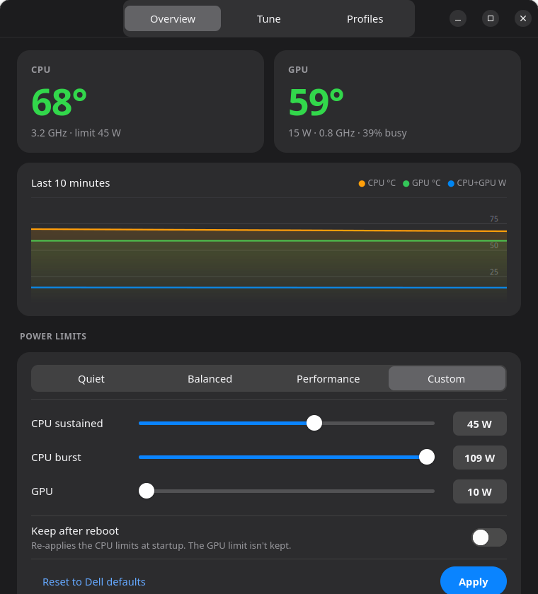

# powerlimit

Native GTK4 app (Rust) to cap CPU/GPU power on a Dell XPS 15 9510 (i7-11800H + RTX 3050 Ti)
and auto-tune the limits per game so the laptop stops overheating.



- **Presets & sliders** for CPU sustained (PL1), CPU burst (PL2) and GPU watts, with a live temperature/power graph.
- **Auto-tune** (open a game, pick it by PID, press *Start tuning*, ~30 min), three phases:
  1. bisects the shared CPU+GPU power budget in 1 W steps up to the thermal ceiling (thermal throttling or your temperature caps);
  2. at the ceiling, moves watts toward the bottleneck (GPU-bound game: CPU to GPU, otherwise the reverse) while the weighted CPU/GPU clock score keeps improving;
  3. picks the knee: the cheapest unthrottled setting within 1.5% of the best score, so it doesn't spend heat and fan noise on the last sliver of MHz.
  It waits for temperatures to level off before measuring and discards samples while the game is idle (menus, pause).
  There is no FPS reading, so "best" means the highest sustained clocks without throttling.
- **Saved profiles** appear in the window with Apply / delete buttons; tick *Auto-apply* (or run `sudo powerlimit watch`) to switch profiles automatically when a game starts.
- Limits live in RAPL (`/sys/class/powercap`) and `nvidia-smi -pl`. They reset on reboot unless you tick *Keep CPU limits after reboot* (or use `set ... --persist`), which installs a udev rule `/etc/udev/rules.d/99-powerlimit.rules` that re-applies the CPU limits when the RAPL device appears at boot - no service. The GPU limit is not kept.
  Some laptops lock the GPU power limit, in which case only the CPU limit is applied.

Other Intel laptops with RAPL may work, but this is only tested on the XPS 15 9510. Use at your own risk.

## Build & install

Needs Rust, GTK 4 dev files (`libgtk-4-dev`), and `pkexec`/polkit. NVIDIA driver for GPU control.

```bash
make && sudo make install          # or:
cmake -B build && cmake --build build && sudo cmake --install build
```

Uninstall with `sudo make uninstall`. Then launch **Power Limiter** from the app menu, or run `powerlimit`.

## CLI

```
powerlimit status
sudo powerlimit set 35 45 30        # CPU PL1, PL2, GPU watts
sudo powerlimit reset
sudo powerlimit tune --game <name> --minutes 30 --cpu-max 85 --gpu-max 80
sudo powerlimit watch
```
Profiles are saved to `/etc/powerlimit/profiles.conf`.
